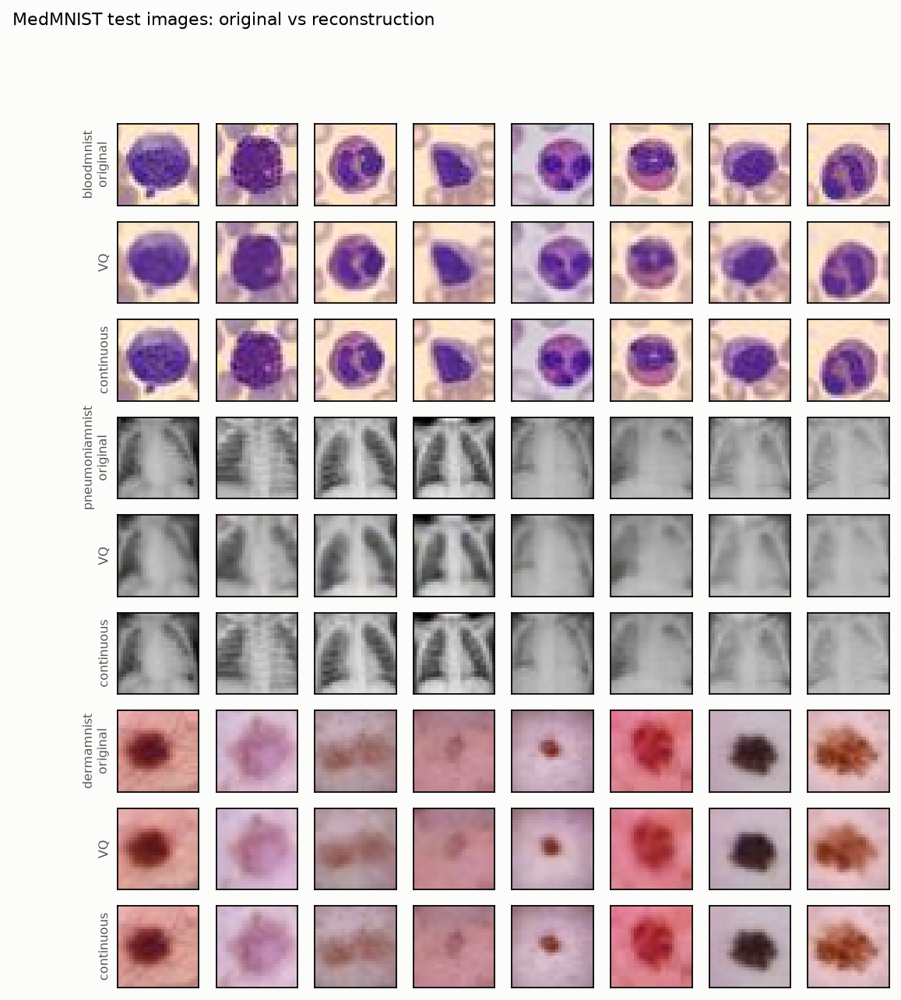
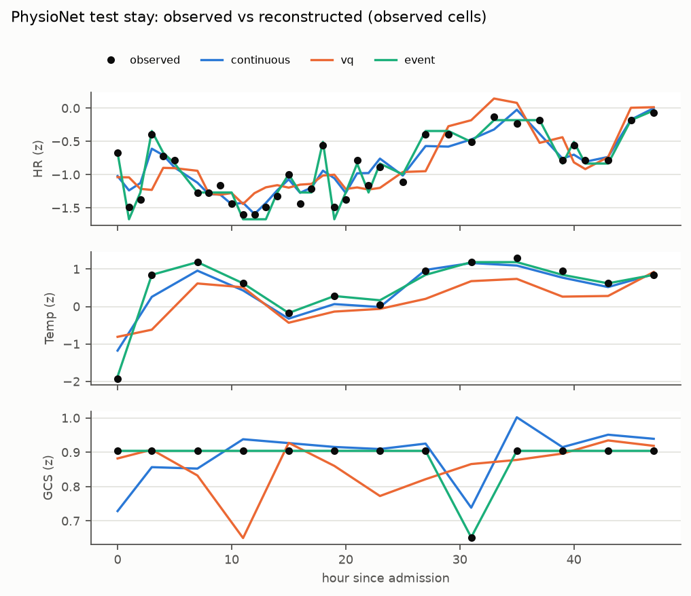
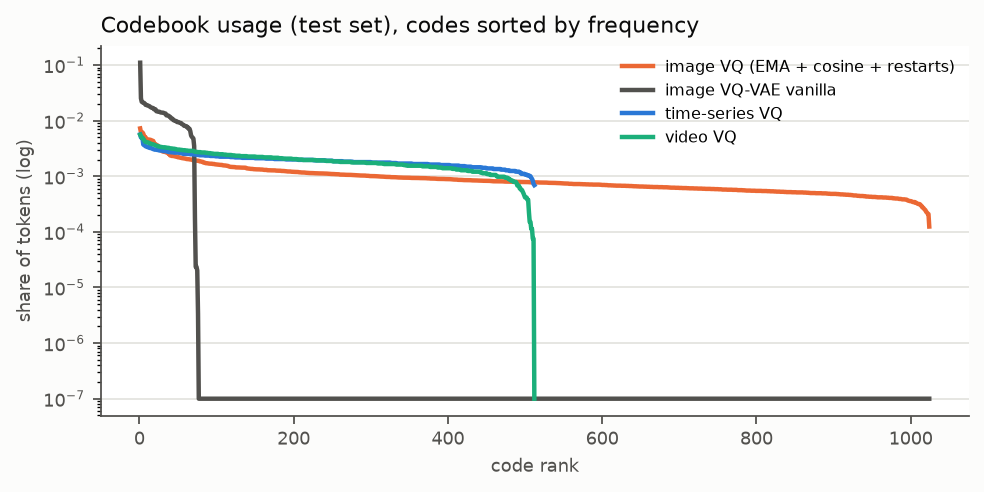
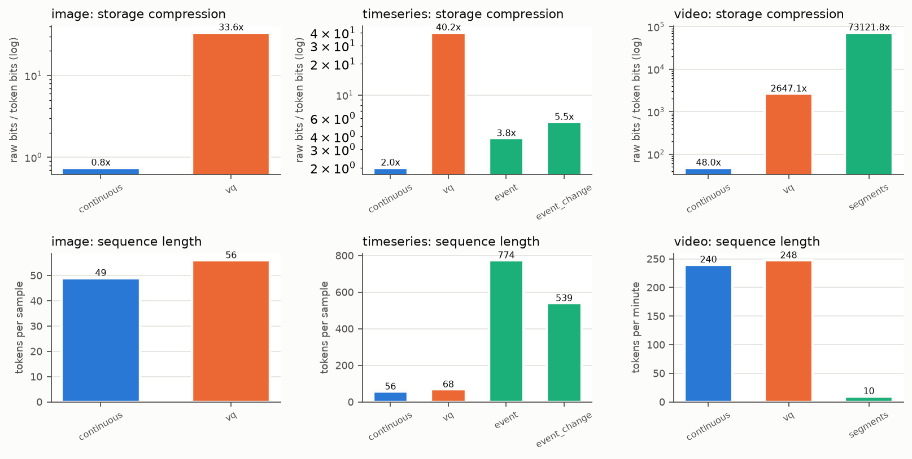
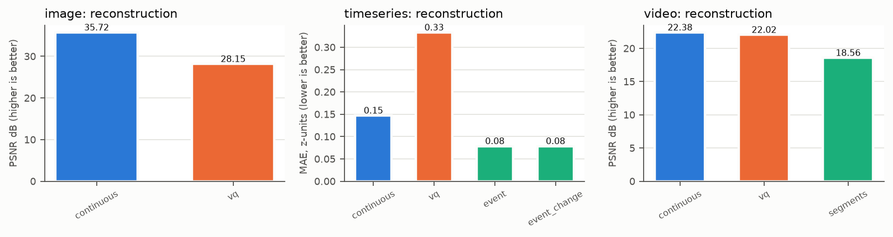
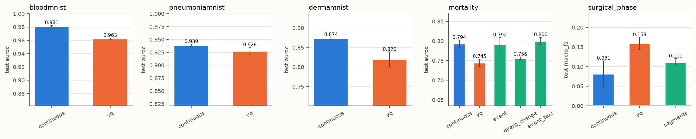
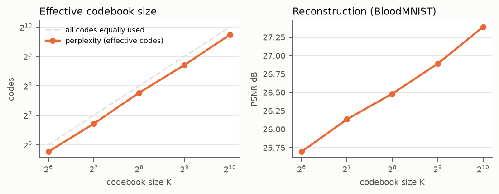
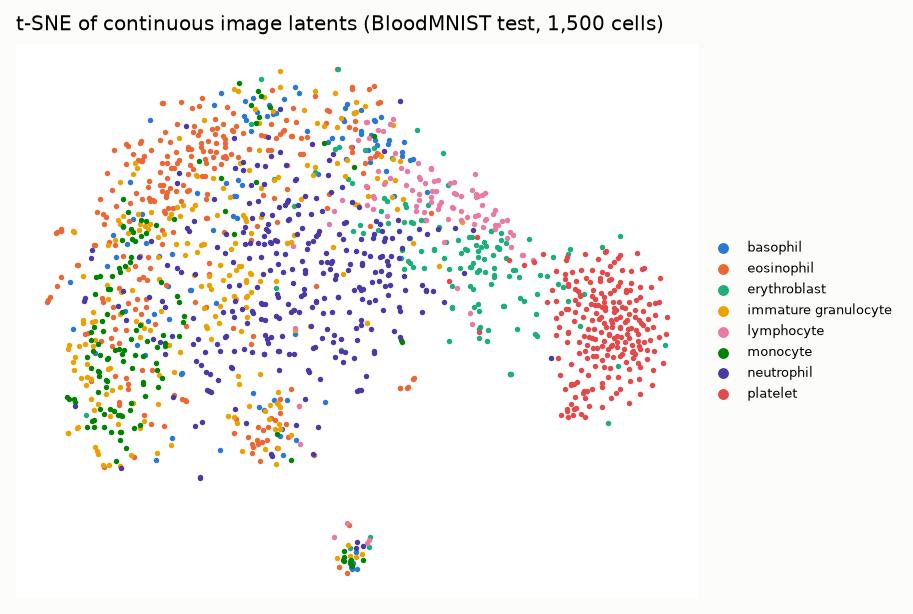
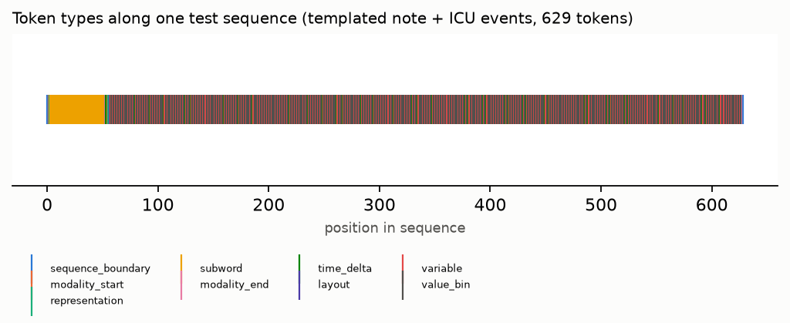

# Results (generated)

Generated by `python -m medical_tokenizer.report` from the `latest` run of each experiment. Do not edit by hand; rerun the command.

### Images (MedMNIST test sets): reconstruction, compression, utilisation

Continuous rows are the continuous baseline: their positions carry fp16 vectors and are NOT vocabulary tokens. '+overhead' adds span delimiters and decoding metadata (docs/token_protocol.md §7).

| experiment | rep | subset | positions | vocab tokens | cont. vectors | PSNR dB | SSIM | MAE | ratio (fixed) | ratio (+overhead) | ratio (entropy) | active codes | util | perplexity |
|---|---|---|---|---|---|---|---|---|---|---|---|---|---|---|
| image_continuous | continuous | bloodmnist | 49.000 | 0.000 | 49.000 | 35.717 | 0.983 | 3.053 | 0.750 | 0.745 | 0.750 | – | – | – |
| image_continuous | continuous | pneumoniamnist | 49.000 | 0.000 | 49.000 | 38.948 | 0.993 | 2.132 | 0.250 | 0.248 | 0.250 | – | – | – |
| image_continuous | continuous | dermamnist | 49.000 | 0.000 | 49.000 | 43.996 | 0.993 | 1.193 | 0.750 | 0.745 | 0.750 | – | – | – |
| image_vq | vq | bloodmnist | 56.000 | 56.000 | 0.000 | 28.149 | 0.916 | 7.457 | 33.595 | 26.350 | 39.298 | 1011 | 0.987 | 568.245 |
| image_vq | vq | pneumoniamnist | 56.000 | 56.000 | 0.000 | 29.823 | 0.944 | 6.435 | 11.198 | 8.783 | 14.879 | 563 | 0.550 | 252.692 |
| image_vq | vq | dermamnist | 56.000 | 56.000 | 0.000 | 32.720 | 0.928 | 4.673 | 33.595 | 26.350 | 41.845 | 962 | 0.939 | 376.231 |
| image_vq_vanilla | vq | bloodmnist | 56.000 | 56.000 | 0.000 | 27.168 | 0.889 | 8.330 | 33.595 | 26.350 | 62.764 | 74 | 0.072 | 45.158 |
| image_vq_vanilla | vq | pneumoniamnist | 56.000 | 56.000 | 0.000 | 29.068 | 0.929 | 6.997 | 11.198 | 8.783 | 22.189 | 74 | 0.072 | 35.442 |
| image_vq_vanilla | vq | dermamnist | 56.000 | 56.000 | 0.000 | 31.191 | 0.903 | 5.593 | 33.595 | 26.350 | 63.971 | 73 | 0.071 | 41.686 |

### Physiological time-series (PhysioNet 2012 test stays)

Errors on observed cells of the hourly grid, per-variable z-units. Gridding error (raw -> hourly grid, shared by all representations) is listed separately. Continuous rows are the continuous baseline: their positions carry fp16 vectors and are NOT vocabulary tokens. '+overhead' adds span delimiters and decoding metadata (docs/token_protocol.md §7). Gridding MAE (z) = 0.073.

| experiment | rep | positions mean | positions max | cont. vectors | MAE (z) | RMSE (z) | ratio (fixed) | ratio (+overhead) | ratio (entropy) | seq. reduction vs obs | active codes / bins | util |
|---|---|---|---|---|---|---|---|---|---|---|---|---|
| timeseries_continuous | continuous | 56.083 | 57 | 48.000 | 0.147 | 0.237 | 1.999 | 1.960 | 2.002 | 7.810 | – | – |
| timeseries_vq | vq | 68.083 | 69 | 0.000 | 0.333 | 0.471 | 40.214 | 28.833 | 45.775 | 6.433 | 512 | 1.000 |
| timeseries_event | event | 773.852 | 1352 | 0.000 | 0.079 | 0.249 | 3.841 | 3.751 | 6.057 | 0.566 | 16 | 1.000 |
| timeseries_event_change | event | 539.369 | 876 | 0.000 | 0.079 | 0.249 | 5.511 | 5.300 | 8.785 | 0.812 | 16 | 1.000 |

### Surgical video (Cataract-101 test videos)

Cataract-101 (10 phases, video-level split) replaces Cholec80; results are not comparable with Cholec80 results. The annotated-phase-event row encodes ground-truth labels: it measures annotation encoding, not phase recognition from raw video. Continuous rows are the continuous baseline: their positions carry fp16 vectors and are NOT vocabulary tokens. '+overhead' adds span delimiters and decoding metadata (docs/token_protocol.md §7).

| experiment | rep | positions/min | PSNR dB | SSIM | ratio (fixed) | ratio (+overhead) | ratio (entropy) | active codes / states | util |
|---|---|---|---|---|---|---|---|---|---|
| video_continuous | continuous | 240.000 | 22.380 | 0.610 | 48.000 | 47.982 | 48.000 | – | – |
| video_vq | vq | 247.500 | 22.024 | 0.600 | 2647.091 | 2593.636 | 2708.865 | 511 | 0.998 |
| video_segments | event | 9.873 | 18.557 | 0.467 | 73121.812 | 53482.877 | 1.49e+05 | 32 | 1.000 |
| annotated phase events (ground-truth labels; annotation encoding only) | event | 3.189 | – | – | 9.336 | 3.473 | – | – | – |

### Downstream tasks (test set, mean ± std over seeds)

Fixed splits and an identical model / training budget per task; class-weighted loss, binary-task cut-off chosen on validation. Images: AUROC and macro-F1; ICU mortality: AUROC and AUPRC. Text in ds_mortality_event_text is synthetic (admission-time fields only, no outcome). Surgical phase uses Cataract-101 and is not comparable with Cholec80 results.

| task | experiment | seq len (train mean) | metric 1 | metric 2 | metric 3 | seeds |
|---|---|---|---|---|---|---|
| bloodmnist | ds_bloodmnist_continuous | 54.000 | auroc 0.981 ± 0.001 | macro_f1 0.820 ± 0.008 | acc 0.840 ± 0.008 | 3 |
| bloodmnist | ds_bloodmnist_vq | 61.000 | auroc 0.963 ± 0.001 | macro_f1 0.749 ± 0.001 | acc 0.779 ± 0.001 | 3 |
| pneumoniamnist | ds_pneumoniamnist_continuous | 54.000 | auroc 0.939 ± 0.002 | macro_f1 0.868 ± 0.003 | acc 0.881 ± 0.000 | 3 |
| pneumoniamnist | ds_pneumoniamnist_vq | 61.000 | auroc 0.928 ± 0.007 | macro_f1 0.807 ± 0.017 | acc 0.832 ± 0.011 | 3 |
| dermamnist | ds_dermamnist_continuous | 54.000 | auroc 0.874 ± 0.003 | macro_f1 0.372 ± 0.003 | acc 0.546 ± 0.005 | 3 |
| dermamnist | ds_dermamnist_vq | 61.000 | auroc 0.820 ± 0.019 | macro_f1 0.295 ± 0.019 | acc 0.529 ± 0.028 | 3 |
| mortality | ds_mortality_continuous | 61.026 | auroc 0.794 ± 0.009 | auprc 0.437 ± 0.008 | balanced_acc 0.711 ± 0.019 | 3 |
| mortality | ds_mortality_vq | 73.026 | auroc 0.745 ± 0.010 | auprc 0.329 ± 0.036 | balanced_acc 0.677 ± 0.007 | 3 |
| mortality | ds_mortality_event | 775.012 | auroc 0.792 ± 0.017 | auprc 0.455 ± 0.021 | balanced_acc 0.683 ± 0.031 | 3 |
| mortality | ds_mortality_event_change | 542.872 | auroc 0.756 ± 0.003 | auprc 0.346 ± 0.016 | balanced_acc 0.666 ± 0.004 | 3 |
| mortality | ds_mortality_event_text | 830.342 | auroc 0.800 ± 0.010 | auprc 0.440 ± 0.014 | balanced_acc 0.711 ± 0.026 | 3 |
| surgical_phase | ds_phase_continuous | 133.000 | macro_f1 0.081 ± 0.034 | acc 0.231 ± 0.037 | balanced_acc 0.130 ± 0.049 | 3 |
| surgical_phase | ds_phase_vq | 137.000 | macro_f1 0.159 ± 0.016 | acc 0.219 ± 0.016 | balanced_acc 0.163 ± 0.022 | 3 |
| surgical_phase | ds_phase_segments | 10.669 | macro_f1 0.111 ± 0.009 | acc 0.140 ± 0.013 | balanced_acc 0.133 ± 0.009 | 3 |
| bloodmnist | ds_multitask_vq (joint) | 61.000 | auroc 0.958 ± 0.005 | – | – | 3 |
| mortality | ds_multitask_vq (joint) | 73.026 | auroc 0.752 ± 0.019 | – | – | 3 |
| surgical_phase | ds_multitask_vq (joint) | 137.000 | macro_f1 0.118 ± 0.026 | – | – | 3 |

### Image codebook size (5 epochs)

| experiment | tokens | PSNR dB (blood) | SSIM (blood) | active codes | util | perplexity | dead % | ratio (fixed) |
|---|---|---|---|---|---|---|---|---|
| abl_image_k64 | 56.000 | 25.694 | 0.862 | 64 | 1.000 | 54.444 | 0.000 | 55.792 |
| abl_image_k128 | 56.000 | 26.134 | 0.873 | 128 | 1.000 | 105.125 | 0.000 | 47.923 |
| abl_image_k256 | 56.000 | 26.483 | 0.881 | 256 | 1.000 | 217.927 | 0.000 | 41.970 |
| abl_image_k512 | 56.000 | 26.890 | 0.891 | 512 | 1.000 | 418.472 | 0.000 | 37.322 |
| abl_image_k1024 | 56.000 | 27.390 | 0.901 | 1024 | 1.000 | 852.622 | 0.000 | 33.595 |

### Image token dimension (5 epochs)

| experiment | tokens | PSNR dB (blood) | SSIM (blood) | active codes | util | perplexity | dead % | ratio (fixed) |
|---|---|---|---|---|---|---|---|---|
| abl_image_dim8 | 56.000 | 27.345 | 0.893 | 512 | 1.000 | 474.181 | 0.000 | 37.322 |
| abl_image_k512 | 56.000 | 26.890 | 0.891 | 512 | 1.000 | 418.472 | 0.000 | 37.322 |
| abl_image_dim64 | 56.000 | 26.827 | 0.889 | 512 | 1.000 | 410.775 | 0.000 | 37.322 |

### Image patch size (patch-embedding architecture, 5 epochs)

| experiment | tokens | PSNR dB (blood) | SSIM (blood) | active codes | util | perplexity | dead % | ratio (fixed) |
|---|---|---|---|---|---|---|---|---|
| abl_image_patch2 | 210.000 | 32.016 | 0.965 | 512 | 1.000 | 444.301 | 0.000 | 9.952 |
| abl_image_patch4 | 56.000 | 26.910 | 0.890 | 512 | 1.000 | 437.981 | 0.000 | 37.322 |
| abl_image_patch7 | 20.000 | 23.722 | 0.781 | 512 | 1.000 | 446.920 | 0.000 | 104.501 |

### Image codebook-collapse remedies (K=512, 5 epochs)

| experiment | tokens | PSNR dB (blood) | SSIM (blood) | active codes | util | perplexity | dead % | ratio (fixed) |
|---|---|---|---|---|---|---|---|---|
| abl_image_k512 | 56.000 | 26.890 | 0.891 | 512 | 1.000 | 418.472 | 0.000 | 37.322 |
| abl_image_norestart | 56.000 | 26.306 | 0.877 | 265 | 0.518 | 174.190 | 48.242 | 37.322 |
| abl_image_nocosine | 56.000 | 27.707 | 0.902 | 512 | 1.000 | 455.616 | 0.000 | 37.322 |
| abl_image_lossupdate | 56.000 | 26.816 | 0.889 | 512 | 1.000 | 424.355 | 0.000 | 37.322 |
| abl_image_vanilla | 56.000 | 25.956 | 0.863 | 64 | 0.125 | 40.951 | 87.500 | 37.322 |

### Time-series codebook size

| experiment | tokens mean | MAE (z) | RMSE (z) | gridding MAE (z) | active codes | util | perplexity | dead % |
|---|---|---|---|---|---|---|---|---|
| abl_ts_k64 | 68.083 | 0.374 | 0.528 | 0.073 | 64 | 1.000 | 63.176 | 0.000 |
| abl_ts_k128 | 68.083 | 0.355 | 0.500 | 0.073 | 128 | 1.000 | 125.102 | 0.000 |
| timeseries_vq | 68.083 | 0.333 | 0.471 | 0.073 | 512 | 1.000 | 492.799 | 0.000 |
| abl_ts_k1024 | 68.083 | 0.321 | 0.458 | 0.073 | 1024 | 1.000 | 972.708 | 0.000 |

### Time-series window size / stride (4 tokens per window)

| experiment | tokens mean | MAE (z) | RMSE (z) | gridding MAE (z) | active codes | util | perplexity | dead % |
|---|---|---|---|---|---|---|---|---|
| abl_ts_win2 | 128.083 | 0.275 | 0.389 | 0.073 | 512 | 1.000 | 489.366 | 0.000 |
| timeseries_vq | 68.083 | 0.333 | 0.471 | 0.073 | 512 | 1.000 | 492.799 | 0.000 |
| abl_ts_win8 | 38.083 | 0.387 | 0.555 | 0.073 | 512 | 1.000 | 490.573 | 0.000 |
| abl_ts_win8_stride4 | 63.083 | 0.343 | 0.496 | 0.073 | 512 | 1.000 | 494.874 | 0.000 |

### Time-series sampling interval (4 h windows)

| experiment | tokens mean | MAE (z) | RMSE (z) | gridding MAE (z) | active codes | util | perplexity | dead % |
|---|---|---|---|---|---|---|---|---|
| abl_ts_res30 | 68.083 | 0.348 | 0.499 | 0.041 | 512 | 1.000 | 494.353 | 0.000 |
| timeseries_vq | 68.083 | 0.333 | 0.471 | 0.073 | 512 | 1.000 | 492.799 | 0.000 |
| abl_ts_res120 | 68.083 | 0.299 | 0.421 | 0.179 | 512 | 1.000 | 494.033 | 0.000 |

### Time-series missing values and collapse

| experiment | tokens mean | MAE (z) | RMSE (z) | gridding MAE (z) | active codes | util | perplexity | dead % |
|---|---|---|---|---|---|---|---|---|
| timeseries_vq | 68.083 | 0.333 | 0.471 | 0.073 | 512 | 1.000 | 492.799 | 0.000 |
| abl_ts_locf | 68.083 | 0.612 | 0.825 | 0.073 | 510 | 0.996 | 262.370 | 0.391 |
| abl_ts_vanilla | 68.083 | 0.345 | 0.500 | 0.073 | 476 | 0.930 | 351.172 | 7.031 |

### Video temporal sampling rate and codebook size (5 epochs)

| experiment | tokens/min | PSNR dB | SSIM | active codes | util | perplexity |
|---|---|---|---|---|---|---|
| abl_video_fps0.5 | 123.750 | 20.755 | 0.543 | 499 | 0.975 | 437.166 |
| abl_video_fps1 | 247.500 | 21.055 | 0.558 | 506 | 0.988 | 439.572 |
| abl_video_fps2 | 495.000 | 21.576 | 0.579 | 506 | 0.988 | 447.443 |
| abl_video_k128 | 247.500 | 21.198 | 0.568 | 127 | 0.992 | 113.932 |
| abl_video_k1024 | 247.500 | 21.220 | 0.560 | 987 | 0.964 | 825.856 |

### Interface modalities

Text: SYNTHETIC templated notes (not clinical free text); accepted on lossless round-trip, field preservation and protocol compatibility only, no claim about clinical language understanding. Point clouds: synthetic surfaces, non-learned features; Chamfer relative to object extent.

| modality | setting | exact round-trip / Chamfer | field preservation | tokens mean | ratio | ratio (+overhead) |
|---|---|---|---|---|---|---|
| text | BPE vocab 972, templates v2 | 1.000 | 1.000 | 51.467 | 3.418 | 3.158 |
| pointcloud | res4 | 0.032 | – | 32.200 | 763.230 | 155.446 |
| pointcloud | res8 | 0.021 | – | 123.700 | 198.674 | 98.462 |
| pointcloud | res16 | 0.016 | – | 425.850 | 57.710 | 44.461 |

## Figures

